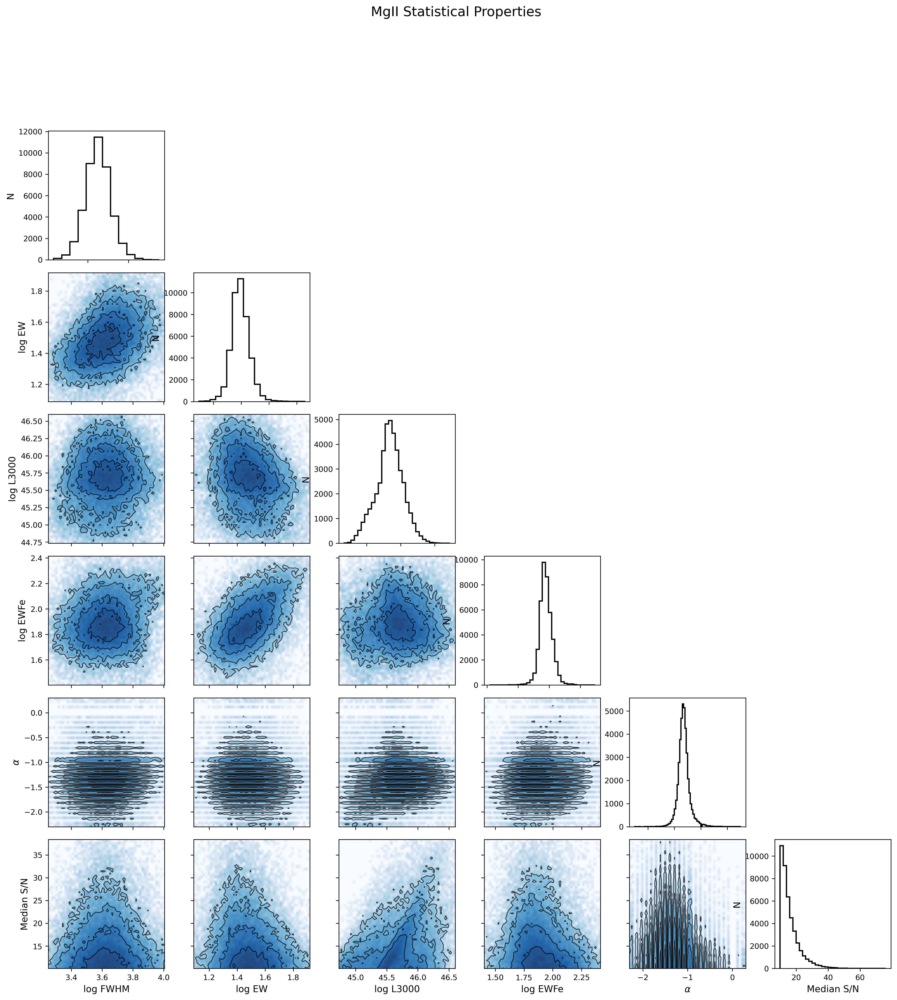
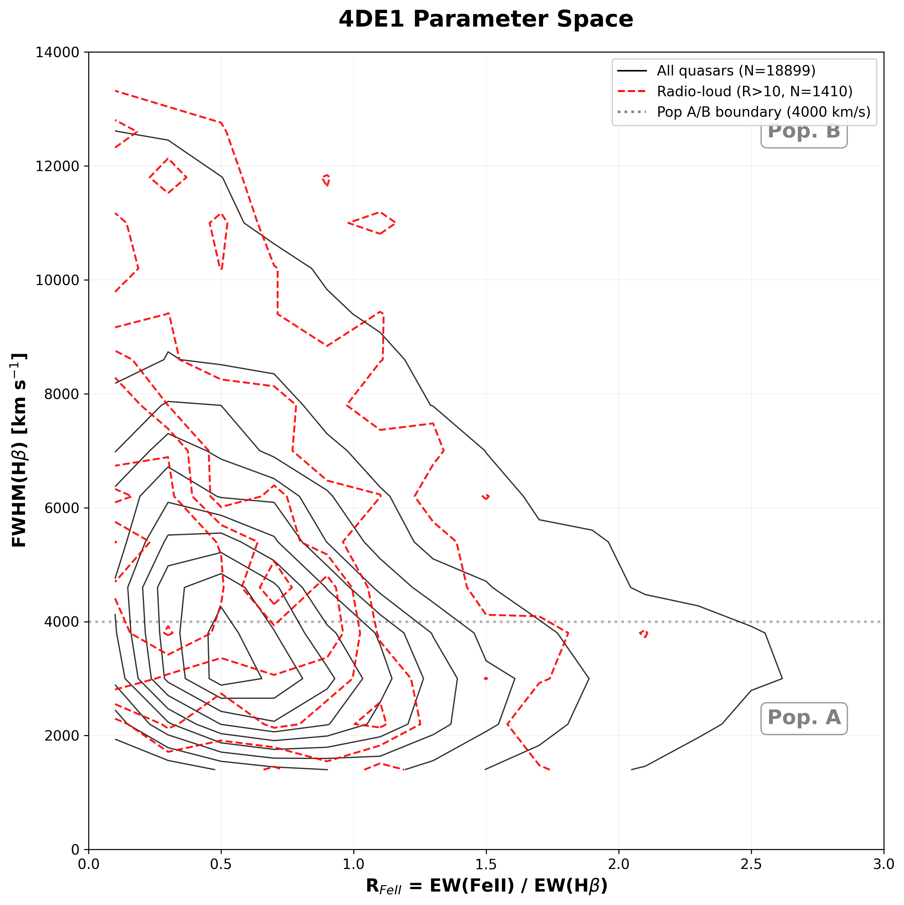

# Replicating Shen et al. (2011): SDSS DR7 quasar properties in Python

An independent, open-source replication of two figures from **Shen et al. (2011), *A Catalog of Quasar Properties from SDSS Data Release 7*** (ApJS 194, 45). The original work used an IDL pipeline. This project uses NumPy, pandas, Matplotlib and Astropy.

Data Science course project, University of Freiburg, winter semester 2025/26.

| Figure 13: MgII properties | Figure 15: 4DE1 space with radio-loud overlay |
|---|---|
|  |  |

## What was replicated

- **Figure 13:** a 6 × 6 corner plot of MgII line properties (FWHM, EW, Fe emission, L3000, continuum slope α, median S/N).
- **Figure 15:** the 4DE1 eigenvector space, FWHM(Hβ) vs. R_FeII = EW(FeII)/EW(Hβ), with a radio-loud (RL > 10) overlay and the Population A/B boundary at 4000 km/s.

## Key results

- **42,333 MgII quasars** after quality cuts, within about 4 % of the ~44k sample in S11 Fig. 13. Histogram peak counts agree at the same level.
- All major correlations were reproduced: the FWHM–EW relation, the **Baldwin effect**, the **Population A/B dichotomy**, and radio-loud quasars preferring Population B (67.7 % vs. 51.8 % overall, an enrichment of about 1.3×).
- **The S/N threshold stated in the paper does not reproduce Fig. 13.** With S/N > 3 (as stated), the sample is 81,316 quasars. Scanning thresholds shows that **S/N > 10** reproduces the published sample size:

| S/N cut | N (MgII) |
|---|---|
| > 3 | 81,316 |
| > 5 | 71,213 |
| > 7 | 59,818 |
| **> 10** | **42,333** |
| > 15 | 18,738 |

- **The striations in the α panels are real, not a plotting artefact.** The catalogue stores α on a grid of 80 discrete values (Δα = 0.1).
- Binning (Δ = 0.1 in log quantities, Δ = 2 in S/N), linearly spaced contour levels, and no Gaussian smoothing were confirmed through correspondence with the first author.

The full write-up, including theory, methods and discussion, is in [`report/`](report/Oprea_Shen2011_replication_report.pdf).

## Repository layout

```
notebooks/
  01_replication_pipeline.ipynb   # Figures 13 and 15, S/N threshold test, alpha investigation
  02_exploratory_analysis.ipynb   # catalogue exploration: M_BH vs z, Eddington ratios, CIV (Figs 8, 14)
figures/                          # output figures
report/                           # LaTeX source + compiled PDF of the final report
data/                             # CDS ReadMe (catalogue schema); catalogue not included
```

## Getting the data

The catalogue (`catalog.dat`, about 130 MB) is larger than GitHub allows and is publicly available from VizieR as **[J/ApJS/194/45](https://cdsarc.cds.unistra.fr/viz-bin/cat/J/ApJS/194/45)**. Download `catalog.dat` into `data/`, next to the `ReadMe` that is already there. The notebooks read it with `astropy.io.ascii` using that ReadMe.

## Setup

```bash
pip install -r requirements.txt
jupyter lab notebooks/
```

## Reference

Shen, Y., Richards, G. T., Strauss, M. A., et al. 2011, ApJS, 194, 45. [doi:10.1088/0067-0049/194/2/45](https://doi.org/10.1088/0067-0049/194/2/45)

## License

Code: MIT (see `LICENSE`). The catalogue and the original figures belong to their authors.
